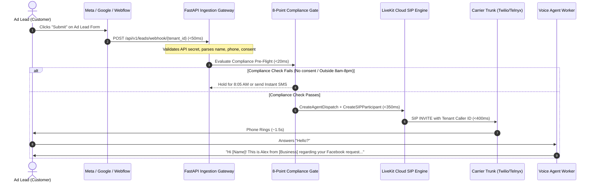

# VedaVoice Engineering Implementation & Milestone Run Sheet

**Version:** 1.2.0  
**Status:** In Progress / Active Development  
**Stack:** Python 3.12 + FastAPI + SQLAlchemy 2.0 (api/), LiveKit Agents Python (agent/), Next.js 15 App Router + TypeScript (dashboard/)

---

## 1. System Implementation Status Overview

| Capability | Module / Layer | Status | Core Verification / Key Attributes |
|---|---|:---:|---|
| **Multi-Tenant Dialed Number Resolution** | `agent/config.py`, `api/` | **Complete** | E.164 normalization, collision rejection at startup, safe unassigned line fallback. |
| **3-Stage Telephony Latency Tracking** | `agent/telemetry.py` | **Complete** | EOU (750ms), LLM TTFT (<350ms), Voice TTS TTFB (<250ms), P50/P95 reporting. |
| **Conversational Edge-Case Safeguards** | `agent/main.py`, `agent/prompts.py` | **Complete** | Idiom disambiguation ("hang on" vs "hang up"), anti-looping defense, async post-call dispatch. |
| **Module 1: Brand Persona & Acoustics** | `portal/profile`, `api/` | **Complete** | Tone archetypes (Direct, Warm, Formal), neural timbre selector, 2-party recording notice, phonetic glossary. |
| **Module 2: FAQ Grounding Engine** | `portal/profile`, `api/` | **Complete** | Categorized canonical Q&As, caller phrasing variation triggers, zero-hallucination guardrail badge. |
| **Module 3: 3-Tier Pricing Guardrails** | `portal/profile`, `api/` | **Complete** | Quoting tiers (`no_quote`, `listed`, `range`), dynamic catalog manager, mandatory verbal disclaimers. |
| **Module 4: Emergency Protocols & Safety** | `portal/profile`, `api/` | **Complete** | Level-1 platform safety gate (gas evacuation, 911 rules, zero arrival promises), hazard keywords, approved safety script, E.164 escalation. |
| **Module 5: Operating Hours & Geofence** | `portal/profile`, `api/` | **Complete** | Timezone clock, weekly schedule matrix, after-hours policy gate, service territory geofence, out-of-area guardrails. |
| **Interactive Help & Info Modal System** | `dashboard/src/context/` | **Complete** | Modal dialogs on all portal settings detailing legal rules, engine mechanics, and caller simulations. |
| **Instant Speed-to-Lead Outbound Engine** | `api/leads`, `agent/outbound` | **In Progress** | 2-second webhook-to-call pipeline for Meta / Google / CRM ad leads passing 8-point compliance gate. |

---

## 2. Speed-to-Lead (<2s) Instant Outbound Calling Architecture

### 2.1 The Problem & Objective
Contractors and high-ticket service businesses lose 80% of inbound ad leads if they do not call within 5 minutes. The **Speed-to-Lead Engine** ingests leads from any advertising source (Facebook Lead Ads, Google Forms, Webflow, Zapier, Make, CRM) and initiates an automated AI phone call **within 2 to 3 seconds** while the prospect still holds their phone.



---

## 3. Detailed Component Blueprint

### 3.1 Webhook Ingestion API (`api/app/routers/leads.py`)
* **Endpoint**: `POST /api/v1/leads/webhook/{tenant_id}`
* **Headers**: `X-VedaVoice-Secret: <tenant_webhook_secret>`
* **Payload**:
  ```json
  {
    "full_name": "Sarah Connor",
    "phone": "+15125550199",
    "email": "sarah@example.com",
    "service_requested": "Water heater replacement",
    "source": "facebook_lead_ad",
    "consent_confirmed": true,
    "consent_timestamp": "2026-11-13T20:30:00Z",
    "consent_text": "Agreed to automated AI phone contact from Apex Plumbing."
  }
  ```
* **Processing**:
  1. Validates `tenant_id` and webhook secret.
  2. Inserts or updates contact in `contacts` table.
  3. Records consent proof in `consents` table.
  4. Dispatches async dialer task immediately via `BackgroundTasks` or message queue.

### 3.2 8-Point Outbound Compliance Gate (`agent/outbound/gate.py`)
Before calling any number, the gate executes 8 automated checks:
1. **Consent Validity**: Verified unrevoked consent record exists for this purpose.
2. **Suppression List**: Phone is not in tenant's `suppressions` table or DNC.
3. **Recipient Local Timezone**: Checks area code/ZIP timezone. Call must occur between **8:00 AM and 8:00 PM local time**.
4. **Frequency Cap**: Maximum 2 outbound attempts per day, 5 per week per contact.
5. **Caller ID Ownership**: Outbound number must be owned and verified by the tenant (STIR/SHAKEN A-attested).
6. **Tenant Concurrency Ceiling**: Must not exceed `max_concurrent_outbound` (default 2 per tenant, 10 global).
7. **Immediate Opt-Out Handler**: If recipient requests opt-out, immediately terminate call and add to suppression.
8. **Mandatory AI Disclosure**: First turn must disclose identity and automated assistant status.

### 3.3 Outbound Lead Conversational Prompt (`agent/prompts.py`)
```
You are {agent_name}, an automated assistant calling from {business_name}.
You are calling {lead_name} in response to their recent online inquiry for {service_requested} on {source}.

GOAL:
1. Disclose identity: "Hi {lead_name}, this is {agent_name}, the automated assistant calling from {business_name}."
2. Hook: "I just received your inquiry regarding {service_requested}."
3. Qualify & Schedule: "I wanted to see if you have 60 seconds to confirm your address and schedule our technician?"
4. Apply Pricing & Emergency Rules: Respect tenant's pricing mode and hazard advice.
5. Voicemail Detection: If an answering machine is detected, leave a concise 12-second message and hang up cleanly.
```

### 3.4 Live Telephony Call Dispatch (`agent/outbound/dialer.py`)
```python
async def trigger_instant_outbound_call(
    lk_api: livekit.api.LiveKitAPI,
    tenant_id: str,
    lead_phone: str,
    caller_id: str,
    trunk_id: str,
    lead_metadata: dict,
) -> str:
    room_name = f"out-{tenant_id}-{uuid.uuid4().hex[:8]}"
    
    # 1. Dispatch Voice Agent Worker to Room
    await lk_api.agent_dispatch.create_dispatch(
        livekit.api.CreateAgentDispatchRequest(
            agent_name="receptionist",
            room=room_name,
            metadata=json.dumps(lead_metadata),
        )
    )
    
    # 2. Ring Lead via SIP Trunk
    participant = await lk_api.sip.create_sip_participant(
        livekit.api.CreateSIPParticipantRequest(
            sip_trunk_id=trunk_id,
            sip_call_to=lead_phone,
            sip_number=caller_id,
            room_name=room_name,
            participant_identity=f"lead-{lead_phone}",
            wait_until_answered=True,
        )
    )
    return participant.sip_call_id
```

---

## 4. Operational Best Practices for Business Owners

1. **The 10-Second "Sweet Spot" Buffer**:
   - Calling in 1.0 second can feel jarring while the customer's finger is still on the screen.
   - An intentional **5 to 10-second buffer** allows the prospect to set their phone down before it rings with a local, trusted caller ID.
2. **After-Hours Holding Queue**:
   - Leads submitted at 1:00 AM are **held in queue** until 8:05 AM in the lead's timezone.
   - An immediate transactional SMS is sent: *"Hi Sarah, we received your after-hours request. Our team will call you first thing at 8:05 AM!"*
3. **A-Attested Caller ID**:
   - Outbound numbers must be verified under the business's legal entity via carrier 10DLC registration to prevent "Spam Likely" flags.

---

## 5. Verification Commands & Testing Run Sheet

```powershell
# 1. Run full test suite (must pass 100%)
powershell -File .\tasks.ps1 test

# 2. Run linter, ruff formatter, and mypy static type analysis
powershell -File .\tasks.ps1 lint

# 3. Simulate Instant Lead Ingestion via Webhook (Local Dev)
$body = @{
    full_name = "Jane Doe"
    phone = "+15125550199"
    email = "jane@example.com"
    service_requested = "Emergency Pipe Leak"
    source = "facebook_ad"
    consent_confirmed = $true
} | ConvertTo-Json

Invoke-RestMethod -Uri http://localhost:8000/api/v1/leads/webhook/apex-plumbing -Method Post -Body $body -ContentType "application/json"
```
