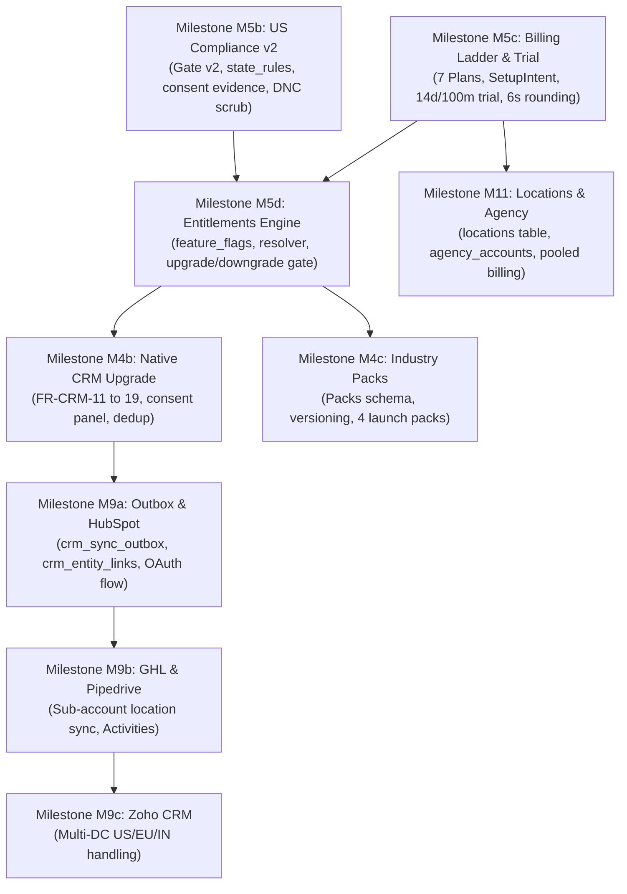

# VedaVoice: Comprehensive Audit & Gap Analysis against SRS Addendum v1.1

> **Document Scope:** Full codebase audit comparing current repository implementation against `SRS_Addendum_v1.1_CRM_Pricing_Compliance_Competitors.md` (2026-11-17 revision 2).  
> **Market Target:** United States only at launch ($299–$499/mo SMB sweet spot + Lite/Scale/Agency ladder).  
> **Repository Context:** `api/` (FastAPI + SQLAlchemy 2.0 + Alembic), `agent/` (LiveKit Agents Python), `dashboard/` (Next.js 15 App Router).

---

## 1. Executive Summary & Audit Scorecard

The VedaVoice codebase contains an operational foundational stack (174 passing automated tests, Next.js 15 production build passing, 8-point compliance engine, LiveKit real-time voice pipeline). During the recent session, the **Native CRM, Visual Kanban Pipeline, Lead Capture Gateways (Google Sheets 2-way sync, universal webhooks, Meta Ads, CSV bulk upload), and initial CRM adapters (HubSpot, Zoho, GoHighLevel, Pipedrive)** were created and mounted.

However, `SRS Addendum v1.1` substantially elevates requirements into an **enterprise-grade, compliance-first, multi-tier product platform**. 

### High-Level Implementation Scorecard

| Addendum Section | Spec Feature Area | Current Status | Implemented | Gaps / Missing |
|---|---|---|---|---|
| **Section 2** | Native CRM Upgrade (FR-CRM-11 to 19) | **65% Complete** | Contacts, pipeline stages, timeline events, audio player, AI summary, sentiment, tags, notes | Multi-pipeline per tenant, contact merge/dedup, consent panel on contact, revenue recovered estimate, disclosure flags in timeline |
| **Section 3** | External CRM Integrations (FR-INT-1 to 13) | **50% Complete** | Direct REST adapters (HubSpot, Zoho, GHL, Pipedrive), background sync dispatcher, HMAC webhooks | Outbox pattern (`crm_sync_outbox` + worker), `crm_entity_links`, OAuth connect/callback flows with encrypted tokens, field mapping UI/API, bidirectional sync with poll fallback |
| **Section 4.1–4.4** | Plan Ladder, Metering & Economics | **55% Complete** | Subscription model, minutes tracking, rollover, overage rates, Stripe webhooks, portal billing page | Full 7-plan ladder (`lite`, `starter`, `growth`, `pro`, `scale`, `enterprise`, `agency`), per-second/6-second rounding, daily cost tracking |
| **Section 4.2** | 14-Day / 100-Minute Free Trial | **60% Complete** | 14-day limit, 100-min cap, trial expired banner, message forwarding mode | Card required at signup (SetupIntent), owner phone verification (OTP), 25-outbound trial cap, abuse controls (fingerprinting, spend cap) |
| **Section 4.5–4.6** | Entitlements & Feature Flags | **15% Complete** | Basic role guards | `plans.entitlements`, `feature_flags` catalog, `tenant_entitlement_overrides`, 4-tier resolution engine, upgrade/downgrade limit checks |
| **Section 4.7** | Industry Packs | **0% Complete** | Static niche prompt templates in `agent/prompts.py` | `industry_packs`, `industry_pack_versions`, `tenant_pack_applications` tables, immutable versioning, pack narrowing for outbound, 4 launch pack seeds |
| **Section 4.8** | Multi-Location (Scale/Enterprise) | **10% Complete** | Timezone awareness on tenant | `locations` table, location-scoped numbers/hours/calendars/bookings/calls, user location permissions, recipient-timezone calling |
| **Section 4.9** | Agency Track (Resellers) | **0% Complete** | Multi-tenancy | `agency_accounts` table, pooled minute billing, client switcher, sub-account retail plan assignment |
| **Section 5** | US Compliance Strict Mode | **70% Complete** | 8-point gate, 8am-8pm window, area-code timezone map, tenant suppression list, frequency caps, LiveKit opt-out tool | Categories A–E formal tagging, `consents` schema upgrade (seller name, category, method, IP, retention), `consent_texts`, `state_rules` table, DNC scrub provider integration, <60s cross-CRM revocation |

---

## 2. Detailed Section-by-Section Gap Analysis

### Section 2: Native CRM (Upgrade of SRS 9.1 & 10.5)

#### What is Currently Implemented:
1. **Schema & Models** (`api/app/models/crm.py`):
   - `Contact` model with `tenant_id`, `name`, `phone`, `email`, `source`, `stage`, `tags` (JSON), `lead_score`, `notes`, `custom_fields`. Unique constraint on `(tenant_id, phone)`.
   - `ContactTimelineEvent` tracking `event_type`, `title`, `description`, `payload`.
   - `EmailCampaign` for follow-up templates and broadcasts.
   - `Call` linked to `Contact` via `contact_id`, with `recording_url`, `sentiment_score`, `sentiment_label`.
2. **REST API** (`api/app/routers/crm.py`):
   - `GET /api/v1/crm/pipeline`: Grouped contacts by 5 Kanban stages.
   - `GET /api/v1/crm/contacts`: Paginated search and filtering.
   - `GET /api/v1/crm/contacts/{id}`: Detailed view with calls and timeline events.
   - `POST /api/v1/crm/contacts`: Create contact.
   - `PATCH /api/v1/crm/contacts/{id}`: Move stage, edit tags/notes.
   - `DELETE /api/v1/crm/contacts/{id}`: Delete contact.
   - `POST /api/v1/crm/campaigns` & `POST /api/v1/crm/campaigns/{id}/send`: Email broadcasting.
3. **Frontend UI** (`dashboard/src/app/portal/crm/page.tsx`):
   - 5-column Visual Kanban Board with quick stage mover.
   - Searchable Contacts table.
   - Detail drawer with interactive `<audio>` player (1x/1.5x/2x speed), AI summary, sentiment badges, and collapsible dialogue transcripts.
   - Email sequence builder and broadcast sender.

#### Exact Gaps & Missing Features (FR-CRM-11 to FR-CRM-19):
- **FR-CRM-11 (Configurable Stages & Multiple Pipelines)**: Stages are currently hardcoded (`new_lead`, `ai_called`, `qualified`, `booked`, `closed`, `lost`). The spec requires tenant-configurable stages and support for secondary pipelines.
- **FR-CRM-13 (Contact Merge & Dedup)**: No API or UI exists to merge two duplicate contacts identified by phone or email.
- **FR-CRM-14 (Consent Panel on Contact)**: Contact detail does not show consent status, consent source, exact consent text version, revoked status, or suppression state.
- **FR-CRM-16 (CSV Consent Attestation)**: The CSV uploader filters DNC suppressions but does not enforce a mandatory "Consent Given" column or attestation checkbox designating non-consented rows as `non-callable`.
- **FR-CRM-18 (Revenue Recovered Estimate)**: Missing tenant-level calculation (`booked_appointments * average_job_value`).
- **FR-CRM-19 (Disclosure Flags on Timeline)**: The contact timeline does not currently display discrete events indicating whether the AI disclosure and Call Recording disclosure were played during a call.

---

### Section 3: External CRM Integrations (Replaces SRS 9.4)

#### What is Currently Implemented:
1. **Direct Adapters** (`api/app/services/integrations/`):
   - `HubSpotAdapter`: Upserts contacts and logs calls with recording URLs.
   - `ZohoAdapter`: Pushes contacts and call activities.
   - `GoHighLevelAdapter`: Creates sub-account contacts and logs outcome notes.
   - `PipedriveAdapter`: Creates persons and schedules call activities.
   - `WebhookDispatcher`: Signs payloads with HMAC-SHA256 for Zapier/Make.
2. **API & UI**:
   - `POST /api/v1/integrations/crm/connect` and `DELETE /api/v1/integrations/crm/{provider}`.
   - `/portal/integrations` card UI with credential input modals.

#### Exact Gaps & Missing Features (FR-INT-1 to FR-INT-13 & Spec 3.2–3.6):
- **Outbox Architecture (`crm_sync_outbox`)**: Currently, sync calls run synchronously inside a FastAPI background task (`sync_dispatcher.py`). If the external CRM API returns 429 or is down, the sync is lost or fails silently. The spec strictly mandates the **Outbox Pattern**:
  - `crm_sync_outbox` table (queued, in_progress, done, failed, dead).
  - Background outbox worker with exponential backoff and dead-letter queue.
- **Entity Linking (`crm_entity_links`)**: Currently, external CRM IDs are not mapped back to internal IDs. The spec mandates a dedicated `crm_entity_links` table mapping `(tenant_id, provider, entity, internal_id) -> external_id` so that updating an appointment or contact updates the *existing* external record instead of creating duplicates.
- **Standardized `CrmProvider` Protocol**: Interface in section 3.2 with `authorize_url`, `exchange_code`, `refresh`, `upsert_contact`, `log_call`, `log_booking`, `create_task`, `set_stage`, `list_changes`, `verify_webhook`, `field_schema`.
- **OAuth 2.0 Web Flows**: Currently, the dashboard asks for raw tokens/keys. The spec requires proper OAuth 2.0 redirect/callback endpoints (`/integrations/{provider}/connect` and `/integrations/{provider}/callback`) with envelope-encrypted token storage (`token_ciphertext bytea`).
- **Field Mapping UI & API**: Endpoints `GET/PUT /integrations/{provider}/field-map` allowing tenants to customize which VedaVoice fields map to which CRM properties.
- **Bidirectional Inbound Sync & Webhooks**: Inbound webhooks from CRMs to catch DNC/Unsubscribe events in under 60 seconds (section 5.6), plus a poll fallback every 5–15 minutes.
- **Zoho Multi-DC Handling**: Zoho US, EU, IN, AU data center routing based on account domain.
- **Transcript Push Opt-In & Signed URLs**: Transcripts must be opt-in only, and recording URLs must point to short-lived signed URLs, not permanent public strings.

---

### Section 4: Plans, Pricing, Metering & Free Trial

#### What is Currently Implemented:
- `Subscription` model with `tier`, `monthly_included_minutes`, `used_minutes_this_cycle`, `trial_days`, `trial_minutes_allocated`, `overage_rate_usd`.
- Stripe webhook processing (`customer.subscription.created/updated/deleted`, `invoice.payment_succeeded`).
- `/portal/billing` UI displaying usage meters and upgrade buttons.

#### Exact Gaps & Missing Features:
- **Missing `plans` Table & 7-Plan Ladder**:
  - Currently, plans are hardcoded strings (`starter`, `pro`, `enterprise`).
  - Spec requires a dedicated `plans` database table holding `lite` ($99, 300 min), `starter` ($299, 1,000 min), `growth` ($399, 1,500 min), `pro` ($499, 2,000 min), `scale` ($999, 4,000 min), `enterprise` (custom), and `agency` (pooled).
- **Billing Granularity**: The spec specifies per-second billing rounded up to the nearest 6 seconds, with no 1-minute minimum penalty.
- **Trial Abuse Controls (FR-TRIAL-1 to 9)**:
  - Stripe SetupIntent (card required at signup before provisioning number).
  - Owner phone verification via SMS/voice OTP.
  - Fingerprint deduplication (one trial per domain, phone, card).
  - Outbound restrictions during trial: Max 25 outbound calls, restricted to owner verified number or consented contacts only.
  - Global trial spend kill-switch (`TRIAL_DAILY_SPEND_CAP_USD`).

---

### Section 4.5–4.6: Entitlements & Feature Flags

#### What is Currently Implemented:
- Basic permission checks via user role (`platform_admin`, `tenant_owner`).

#### Exact Gaps & Missing Features:
- **Database Tables**:
  - `feature_flags` catalog (keys: `crm.native`, `crm.connectors.max`, `calendar.max_connections`, `calendar.round_robin`, `outbound.categories`, `outbound.campaigns`, `numbers.max`, `seats.max`, `locations.max`, `transfer.mode`, `languages`, `retention.transcript_days`, `retention.recording_days`, etc.).
  - `tenant_entitlement_overrides` table (admin granted, expiration date, audit reason).
- **4-Tier Entitlement Resolver**:
  - `plans.entitlements` -> Trial defaults -> Tenant overrides -> **Hard compliance constraints (never overridable)**.
- **Endpoints**: `GET /api/v1/entitlements` (cached 60s) returning active limits. Server-side rejection of actions exceeding plan entitlements (e.g. Lite attempting to connect a 2nd CRM or place outbound Category C calls).
- **Prorated Upgrades & Excess Resource Downgrade Gate**: Downgrade blocks if excess seats, numbers, or calendars are not removed first.

---

### Section 4.7: Industry Packs

#### What is Currently Implemented:
- Hardcoded prompt templates in `agent/prompts.py` for HVAC, plumbing, and general intake.

#### Exact Gaps & Missing Features (FR-PACK-1 to 7):
- **Database Schema**:
  - `industry_packs`: Global platform catalog (`general`, `home_services`, `legal_intake`, `dental_clinic`, `medspa_wellness`, `real_estate`, `automotive`, `beauty_fitness`, `professional_services`, `restaurant_hospitality`, `multi_location`).
  - `industry_pack_versions`: Immutable versioning containing `prompt_base`, `prompt_vars_schema`, `faq_seed`, `appointment_types`, `intake_questions`, `pipeline_stages`, `emergency_rules`, `outbound_scripts`, `test_scenarios`.
  - `tenant_pack_applications`: Tenant-specific copy with `overrides` JSON preserving tenant customizations across pack upgrades.
- **Pack Category Narrowing Rule**: Pack can only narrow outbound categories (e.g., `dental_clinic` narrows to Category B only; healthcare blocks transcript sync to external CRMs until HIPAA BAA is enabled).
- **Automated Test Scenarios**: A pack cannot be set to `active` until at least 10 automated conversational test scenarios pass.

---

### Section 4.8: Multi-Location (Scale & Enterprise)

#### What is Currently Implemented:
- Single timezone and phone number pool per tenant.

#### Exact Gaps & Missing Features (FR-LOC-1 to 5):
- **`locations` Table**: Multi-location tenants with location-specific hours, numbers, calendars, appointment types, and transfer numbers.
- **Location-Scoped User Roles**: `users.location_ids` array restricting staff to specific store or branch data.
- **Recipient-Based Compliance Windows**: Calling window rules must use recipient local time, never location time.

---

### Section 4.9: Agency Track (Resellers)

#### What is Currently Implemented:
- None.

#### Exact Gaps & Missing Features (FR-AGY-1 to 5):
- **`agency_accounts` Table**: Reseller account holding pooled wholesale minutes.
- **Sub-Account Tenant Linking**: `tenants.agency_account_id` and `tenants.billing_mode = 'agency'`.
- **Agency Console & Client Switcher**: Agency admin manages client provisioning, retail plan assignment, and pooled minute exports.

---

### Section 5: US Compliance Strict Mode (Gate v2 & Legal Landscape)

#### What is Currently Implemented:
- `api/app/services/compliance.py` with 8-point gate:
  - Calling window check (8:00 AM – 8:00 PM recipient local time derived from area code).
  - Internal tenant suppression check (`suppression_records`).
  - Frequency caps (1 call/24h per lead).
  - Outbound concurrency caps.
  - E.164 phone normalization.
- LiveKit voice opt-out detection tool in `agent/tools/opt_out.py`.

#### Exact Gaps & Missing Features (Section 5.1–5.9):
- **Call Categories A–E Formalization**:
  - Category A: Inbound.
  - Category B: Transactional / reminders / requested call-backs (prior express consent).
  - Category C: Speed-to-lead follow-up (prior express written consent naming AI voice).
  - Category D: Reactivation of past customers (marketing consent).
  - Category E: Cold calling / purchased lists (**Hard-blocked in code**).
- **`consents` Schema Upgrade**:
  - Missing columns: `category` (B/C/D), `consent_text_id`, `ai_voice_disclosed`, `method` (`web_form`, `sms_reply`, `verbal_recorded`, `in_person`, `crm_import`), `form_url`, `ip`, `user_agent`, `seller_name`, `revoked_via`, `revoked_at_call_id`, `retention_until` (5-year retention).
- **`consent_texts` & `state_rules` Tables**:
  - `consent_texts`: Versioned legal text library.
  - `state_rules`: State-specific calling windows (e.g. Florida 8am–8pm, Washington, Oklahoma frequency limit of 3 calls/24h on same subject, all-party recording consent flags).
- **DNC Scrub Integration**:
  - Automated scrubbing against Federal and State Do-Not-Call registries for Categories C & D with 31-day cache.
- **Sub-60-Second Bidirectional Revocation Propagation**:
  - Spoken in-call opt-out or CRM DND flag must propagate across all active campaigns and external CRMs within 60 seconds.
- **Complaint-Rate Auto-Pause (Kill Switch)**:
  - 3 complaints or carrier spam label signals within 24 hours automatically pauses outbound dialing for that tenant.

---

## 3. Comprehensive Implementation Roadmap & Milestones

Following the milestone specification in Section 8 of the Addendum, the implementation is structured into 8 modular milestones:

### Detailed Milestone Breakdown

#### Milestone M5b: Compliance Engine v2 & Consent Capture
- **Target Files**:
  - Create `api/app/models/compliance.py`: `StateRule`, `ConsentText`, upgraded `ConsentRecord`.
  - Update `api/app/services/compliance.py`: Upgrade to Gate v2 (10-point evaluation, Category A–E logic, DNC scrub cache, state-specific rules).
  - Update `agent/main.py` & `agent/tools/opt_out.py`: Immediate sub-60-second suppression write and background webhook dispatch.
- **New Tests**: `api/tests/test_compliance_v2.py` (Category gating, state window overrides, DNC scrub integration, in-call opt-out propagation).

#### Milestone M5c: Plans Ladder, Billing & Trial Abuse Controls
- **Target Files**:
  - Create `api/app/models/plan.py`: `Plan` model (`lite`, `starter`, `growth`, `pro`, `scale`, `enterprise`, `agency`).
  - Update `api/app/models/tenant.py`: Add `plan_code`, `billing_mode`, `trial_started_at`, `trial_ends_at`, `trial_minutes_used`.
  - Update `api/app/routers/subscriptions.py`: Stripe SetupIntent on trial onboarding, 14-day / 100-min dual expiry engine, 25 outbound trial cap, 6-second rounding.
- **New Tests**: `api/tests/test_plans_and_trial_lifecycle.py`.

#### Milestone M5d: Entitlements & Feature Flag Resolver
- **Target Files**:
  - Create `api/app/models/entitlement.py`: `FeatureFlag`, `TenantEntitlementOverride`.
  - Create `api/app/services/entitlements.py`: 4-tier resolver (Plan -> Trial -> Overrides -> Hard Compliance).
  - Update `api/app/routers/admin.py`: `PUT /admin/tenants/{id}/entitlement-overrides`.
  - Create `api/app/routers/entitlements.py`: `GET /api/v1/entitlements` (cached 60s).
- **New Tests**: `api/tests/test_entitlements_resolver.py` (Plan limit enforcement, override audits, compliance non-bypassability).

#### Milestone M4b: Native CRM Upgrade (FR-CRM-11 to 19)
- **Target Files**:
  - Update `api/app/models/crm.py`: Custom pipeline stages per tenant, contact merge table, disclosure flags.
  - Update `api/app/routers/crm.py`: Contact deduplication/merge endpoint, consent audit panel endpoint, revenue recovered calculation.
  - Update `dashboard/src/app/portal/crm/page.tsx`: Consent evidence tab on drawer, revenue recovered widget, disclosure timeline badges.
- **New Tests**: `api/tests/test_crm_v2_features.py`.

#### Milestone M9a: Outbox Pattern & HubSpot Connector v2
- **Target Files**:
  - Create `api/app/models/crm_sync.py`: `crm_connections`, `crm_entity_links`, `crm_sync_outbox`.
  - Create `api/app/services/integrations/outbox_worker.py`: Async outbox processor with exponential backoff and dead-letter queue.
  - Refactor `api/app/services/integrations/hubspot.py`: Full `CrmProvider` protocol implementation with OAuth exchange and encrypted tokens.
  - Update `api/app/routers/integrations.py`: OAuth `/connect` and `/callback` routes.
- **New Tests**: `api/tests/test_crm_outbox_and_hubspot.py`.

#### Milestone M9b: GoHighLevel & Pipedrive Connectors v2
- **Target Files**:
  - Refactor `api/app/services/integrations/gohighlevel.py`: Location API v2 sub-account mapping, Notes, Tasks, Opportunities.
  - Refactor `api/app/services/integrations/pipedrive.py`: Person, Deal, Activity sync.
- **New Tests**: `api/tests/test_ghl_pipedrive_connectors.py`.

#### Milestone M9c: Zoho CRM Connector v2 (Multi-DC)
- **Target Files**:
  - Refactor `api/app/services/integrations/zoho.py`: US, EU, IN, AU data center routing, token refresh, and summary length handling.
- **New Tests**: `api/tests/test_zoho_multi_dc.py`.

#### Milestone M4c: Industry Packs Engine
- **Target Files**:
  - Create `api/app/models/industry_pack.py`: `IndustryPack`, `IndustryPackVersion`, `TenantPackApplication`.
  - Create `api/app/services/industry_packs.py`: Pack application, versioning, outbound narrowing, test runner.
  - Seed 4 Launch Packs: `general`, `home_services`, `legal_intake`, `dental_clinic`.
- **New Tests**: `api/tests/test_industry_packs.py` (Immutable versions, category narrowing, healthcare sync blocking).

#### Milestone M11: Multi-Location & Agency Track
- **Target Files**:
  - Create `api/app/models/location.py`: `Location` model.
  - Create `api/app/models/agency.py`: `AgencyAccount` model.
  - Update `api/app/models/user.py`: `location_ids` array.
  - Update `dashboard/src/app/portal/layout.tsx`: Location switcher and Agency client switcher.
- **New Tests**: `api/tests/test_multilocation_and_agency.py`.

---

## 4. Verification & Defense Strategy

Every milestone will adhere strictly to `AGENTS.md`:
1. **Multi-Tenancy with RLS**: All newly introduced tables (`plans`, `crm_connections`, `crm_sync_outbox`, `industry_packs`, `locations`, `agency_accounts`) will have Row-Level Security enabled and verified by cross-tenant tests.
2. **Deterministic Compliance Tests**: Tests verifying that no API call, CSV import, or CRM trigger can bypass Gate v2.
3. **Continuous Build Verification**: Running `pytest api/tests agent/tests -q`, `npm --prefix dashboard run build`, and `ruff check .` on each incremental commit.
